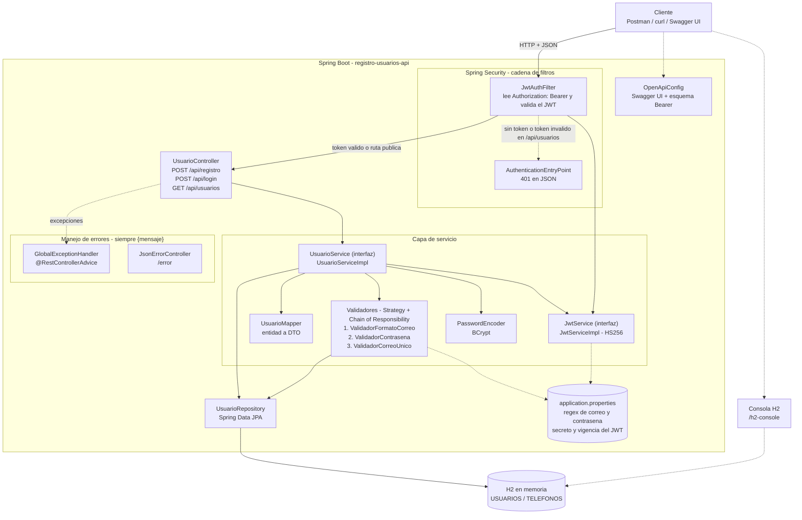
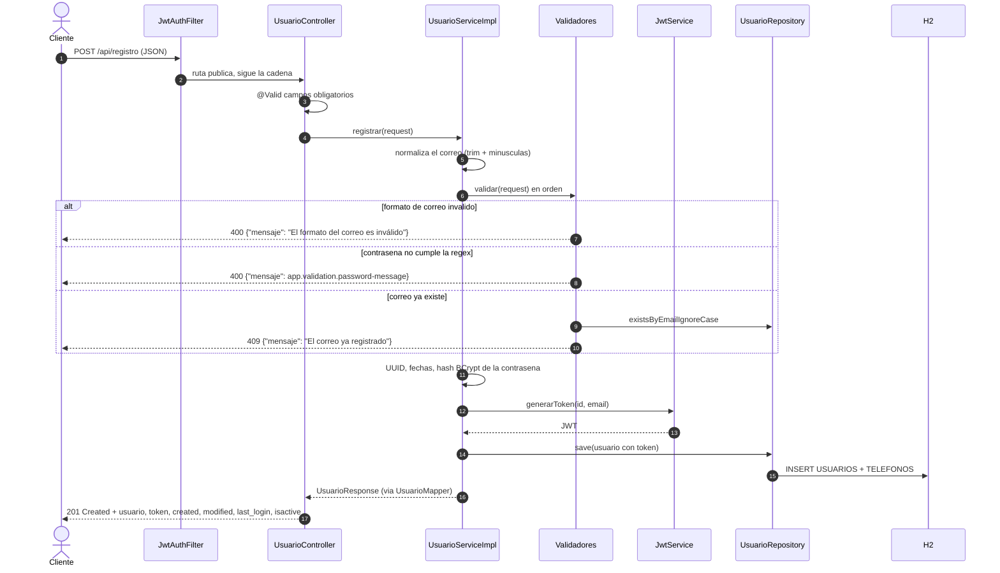
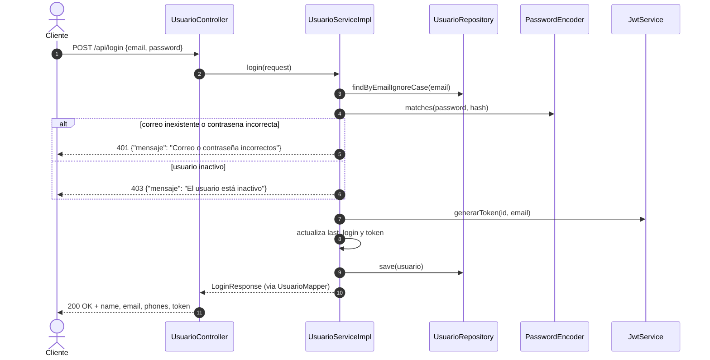
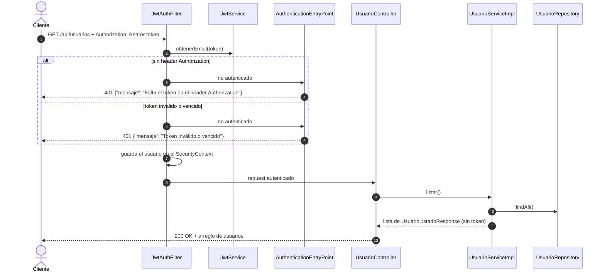
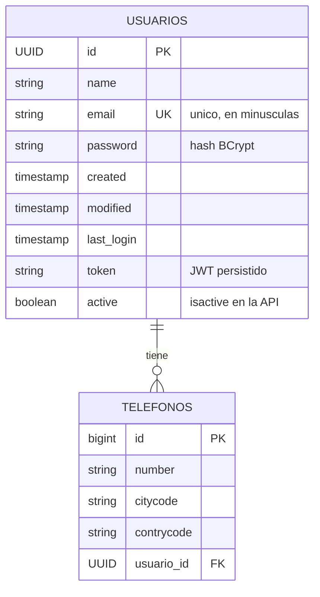

# Diagrama de la solucion

## 1. Arquitectura de componentes

Arquitectura en capas: Spring Security -> Controller -> Service -> Repository -> Base de datos.



## 2. Secuencia: registro (`POST /api/registro`)



## 3. Secuencia: login (`POST /api/login`)



## 4. Secuencia: listado protegido (`GET /api/usuarios`)



## 5. Modelo de datos



## 6. Estructura de paquetes

```
com.example.usuarios
├── RegistroUsuariosApplication     Punto de entrada de Spring Boot
├── config/        OpenApiConfig            Swagger y esquema Bearer
├── controller/    UsuarioController        Endpoints REST
├── dto/           Requests y responses     Contrato JSON de la API
├── exception/     GlobalExceptionHandler, JsonErrorController, ApiException
├── mapper/        UsuarioMapper            Entidad a DTO
├── model/         Usuario, Telefono        Entidades JPA
├── repository/    UsuarioRepository        Acceso a datos
├── security/      SecurityConfig, JwtAuthFilter, JwtService, JwtServiceImpl
├── service/       UsuarioService (interfaz) y impl/UsuarioServiceImpl
└── validation/    ValidadorRegistro y sus 3 implementaciones
```
